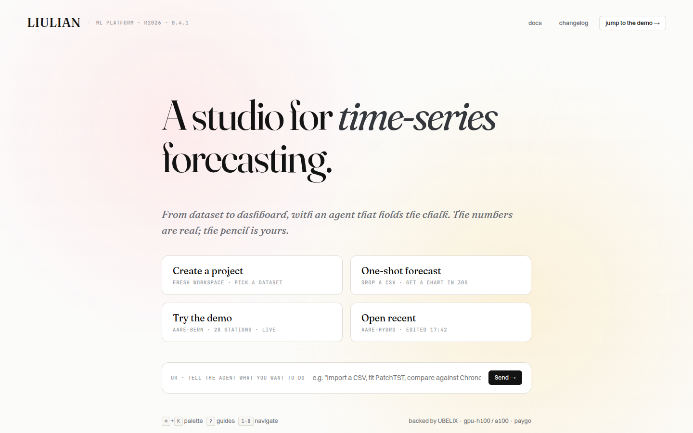
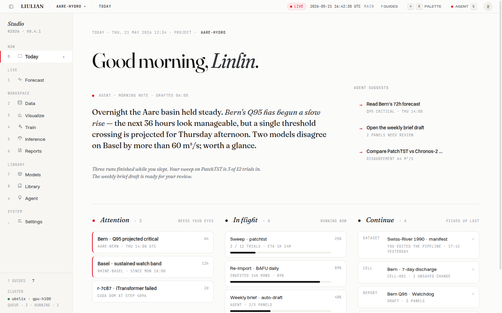
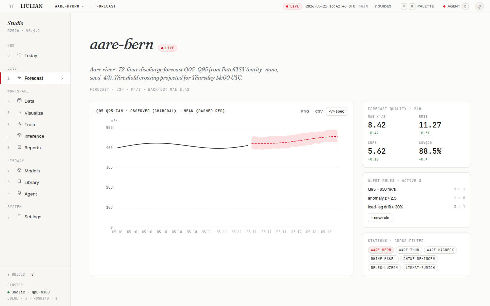
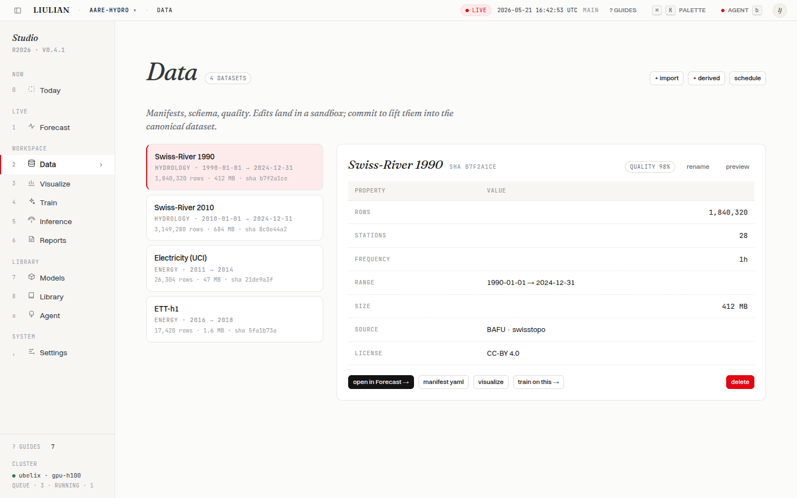
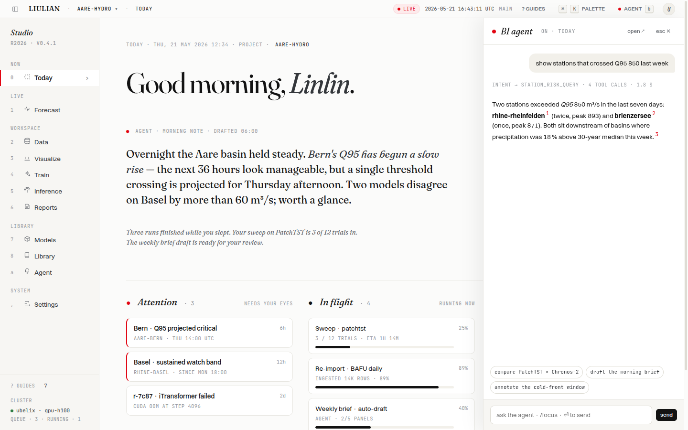

# liulian-web

> The studio for time-series forecasting — Next.js 14 + Claude-Design
> handoff. Doorway → Today → Forecast → Data → Visualize → Train → …
> One page per surface, an agent that holds the chalk.

[](https://liulian-ai.github.io/liulian-web/web-demo.html)
[](https://github.com/liulian-ai/liulian-docs)
[](https://nextjs.org/)
[](https://pnpm.io/)
[](LICENSE)
[](https://github.com/liulian-ai/liulian-web/actions)

## What this looks like

The Doorway is the first thing a visitor sees — a single hero, four
entry cards, an agent input. Pick one and the studio opens.



**Today** is the daily landing. Agent has drafted a morning note; three
columns surface what needs your eyes, what's running, and what to pick
back up:



**Forecast** opens to a live Q05–Q95 fan with PatchTST · entity=none ·
seed=42. Charts, KPIs, alert rules and station cross-filter stay in
sync. The `</> spec` button reveals the underlying JSON the agent edits:



**Data** is the catalogue + manifest editor. Quality % is computed
nightly; commits land as versioned transforms:



**Agent rail** is anchored, not stuffed in a corner. It speaks from
where you look — F1 spatial anchoring, F2 prefetch, F4 visible
reasoning — and the chat history doubles as the audit log:



## Try the demo locally

The demo at [`docs/web-demo.html`](https://liulian-ai.github.io/liulian-web/web-demo.html) is what the
screenshots above show. It's the **full Claude-Design handoff bundle**
(`index.html` + `data.jsx` + `app.jsx` + `pages/*.jsx` + `components/*.jsx`)
served as static React-via-Babel — no build, no npm install:

```bash
# from the repo root
cd docs/ && python3 -m http.server 8950
# then open http://127.0.0.1:8950/web-demo.html
```

The demo is **fully clickable** — every button + every nav row + every
chart action is wired. Mock actions surface a toast labelled
`(mock)` so it's obvious which interactions are stubbed for the
prototype and which are real (the keyboard, the routing, the agent
drawer toggle, the project switcher, the cross-filter, the chart
rendering — all real).

Keyboard map (also reachable via `?`):

| Key | What it does |
|---|---|
| `⌘`/`Ctrl` + `K` | command palette |
| `B` | toggle agent drawer |
| `0` – `8` | jump to a page (Today · Forecast · Data · Visualize · Train · Inference · Reports · Models · Library) |
| `A` | open the Agent thread page |
| `,` | open Settings |
| `?` | guides modal |
| `Esc` | close any modal |

## Where the design came from

The visual language is from a Claude Design handoff bundle at
[`references/liulian-handoff-claude-design-2026.05.21.zip`](references/liulian-handoff-claude-design-2026.05.21.zip)
— Fraunces (display) + Switzer (body) + JetBrains Mono (numbers),
UniBe red as the single accent, hairlined cards, mode-A / mode-B /
mode-C interaction grammar. The full design specs (R6/R7/R8 rounds,
LiulianChartSpec contract, fused-mode F1-F6 principles) live in:

- [`docs/specs/2026-05-20-forecast-redesign-design.md`](docs/specs/2026-05-20-forecast-redesign-design.md) — R5 lock
- [`docs/specs/2026-05-21-forecast-dashboard-design.md`](docs/specs/2026-05-21-forecast-dashboard-design.md) — R8 lock
- [`docs/redesign-2026-05-20/`](docs/redesign-2026-05-20/) — R1–R5 round-by-round mocks + critique notes
- [`docs/redesign-2026-05-21/`](docs/redesign-2026-05-21/) — R6–R8 dashboard / twin-track editing

Cross-cutting platform docs (federation map, user stories, ADRs) live
in [`liulian-docs`](https://github.com/liulian-ai/liulian-docs).
Design tokens + reference designs are in
[`liulian-design-system`](https://github.com/liulian-ai/liulian-design-system).

## Develop the real Next.js app

```bash
pnpm install --frozen-lockfile
pnpm dev                # http://localhost:3000
pnpm test               # Vitest unit + component (~270 tests)
pnpm exec tsc --noEmit  # TypeScript check
pnpm exec next lint     # ESLint
pnpm build              # production build
```

### Common commands

| Command | What it does |
|---|---|
| `pnpm dev` | dev server (`localhost:3000`) |
| `pnpm build` | production build |
| `pnpm lint` | ESLint |
| `pnpm test` | Vitest unit + component (274 tests) |
| `pnpm test:watch` | Vitest watch mode |
| `pnpm test:e2e` | Playwright E2E (Chromium) |
| `pnpm storybook` | Storybook component preview (`localhost:6006`) |

### Environment variables

Create `.env.local` from the documented template — required keys:

- `NEXT_PUBLIC_BACKEND_API_URL` — `liulian-api` base
- `NEXT_PUBLIC_AGENT_BASE_URL` — `liulian-agent` base
- `NEXT_PUBLIC_CLERK_PUBLISHABLE_KEY` — Clerk auth publishable key
- `CLERK_SECRET_KEY` — Clerk secret

The deploy SSH key (production push) is configured at the repo level
under `DEPLOY_SSH_KEY`. See
[`liulian-ops/docs/deployment-guide.md`](https://github.com/liulian-ai/liulian-ops/blob/main/docs/deployment-guide.md).

## Project structure

```
liulian-web/
├── web-demo.html               ← single-file React demo (this is what the screenshots show)
├── docs/
│   ├── screenshots/            ← the images above
│   ├── redesign-2026-05-20/    ← R1–R5 forecast canvas mocks
│   ├── redesign-2026-05-21/    ← R6–R8 dashboard / twin-track edit mocks
│   └── specs/                  ← R5 + R8 design specs (locked)
├── references/                 ← Claude-Design handoff bundles
├── app/                        ← Next.js App Router pages
├── components/chat/            ← chat / agent surface
├── _legacy-bak/                ← quarantined neobanker-era code (see liulian-docs/agile/ci-skips-2026-05-21.md)
├── contexts/                   ← React contexts (Chat, Canvas, …)
├── hooks/                      ← shared hooks
├── messages/                   ← i18n (EN / zh-CN / zh-HK)
├── packages/ui-react/          ← cross-platform component library
└── __tests__/                  ← Vitest tests
```

## Federation cross-reference

| Repo | What it owns |
|---|---|
| [`liulian-web`](https://github.com/liulian-ai/liulian-web) (here) | the BI canvas, web demo, redesign rounds |
| [`liulian-python`](https://github.com/liulian-ai/liulian-python) | ML core — datasets, models, runtime |
| [`liulian-api`](https://github.com/liulian-ai/liulian-api) | REST surface over the ML core |
| [`liulian-agent`](https://github.com/liulian-ai/liulian-agent) | LLM gateway + BI agent (SSE) |
| [`liulian-mobile`](https://github.com/liulian-ai/liulian-mobile) | native iOS / Android / HarmonyOS |
| [`liulian-design-system`](https://github.com/liulian-ai/liulian-design-system) | tokens · references · UI audit |
| [`liulian-docs`](https://github.com/liulian-ai/liulian-docs) | federation hub (ADRs, user stories, agile) |
| [`liulian-dev-env`](https://github.com/liulian-ai/liulian-dev-env) | local stack · cluster setup |
| [`liulian-ops`](https://github.com/liulian-ai/liulian-ops) | deploy CLI · runbooks · cost ledger |

## License

MIT
